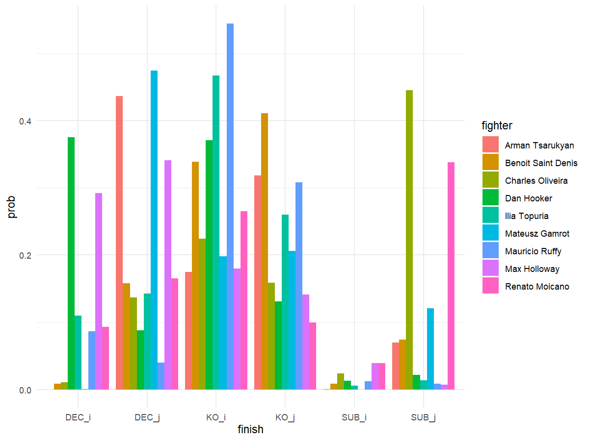

## Education
Masters of Statistics in Econometrics, MS | University of Utah (2024–2025)  
Business Economics and Analytics, BS | University of Utah (2022–2024)

## Languages
PYTHON, R, STATA, MATLAB

## Work Experience
Finance Intern – Nicholas & Company  
- Revised old customer contracts, identified inefficiencies, and saved $30,000.

## Projects
### <b>Masters Project<b> - UFC Prediction Model Using Markov Chains
- Language: R
- Categorized fighters using 13 different skills models.
- Estimated transition probabilities from historical fight data. 
- Simulated bout outcomes of the top 11 fighters in the lightweight division.

### <b>Gambler's Ruin<b> - Expected Value Forecasting
- Language: Python
- Created an arbitrage simulator that can calculate expected value given paramater inputs.

  
